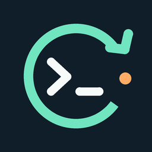

<p align="center">
  
</p>
<h1 align="center">Rekindle</h1>
<p align="center"><strong>Your terminal agents, right where you left them.</strong></p>

Rekindle remembers the conversations running in your VS Code terminals and restores them when you reopen the workspace. Open a terminal and use your agent normally. There is no session picker to maintain.

## What it does

- Tracks each terminal's conversation ID, working directory, and title automatically.
- Restores the exact conversation, rather than whichever session was used most recently.
- Opens the Terminal panel and focuses the first successfully restored agent.
- Preserves normal shell integration by launching the agent inside your regular shell.
- Removes an untouched startup shell only after an agent is restored, and only if the shell has no child processes. With no agents to restore, the default shell stays.
- Provides an English **Rekindle → Sessions** sidebar for inspecting or forgetting tracked sessions.

## Optional manual sessions

Use the **+** button in the Rekindle sidebar or run **Rekindle: Add Session** to add an existing conversation manually. Codex and pi offer a local history picker; all four agents accept an exact saved session ID and project folder. Automatic tracking remains the default and requires no manual list.

## Agents

| Agent | How it is tracked | Restore command |
| --- | --- | --- |
| Codex | Process ancestry and open session files | `codex resume <id>` |
| pi | A local session-event extension | `pi --session <file>` |
| Claude Code | Local `SessionStart` and `UserPromptSubmit` hooks | `claude --resume <id>` |
| Antigravity CLI / AGY | Local `SessionStart` and `PreInvocation` hooks | `agy --conversation <id>` |

Automatic tracking is currently implemented for **macOS**. Other platforms are not yet supported by the process observer.

## Install

Build a VSIX locally:

```sh
npm ci
npm run package
code --install-extension rekindle.vsix
```

Load the updated extension, then use a normal terminal. Existing pi processes need one `/reload` after initial installation to load the observer. Claude Code and AGY load their hooks in a new CLI session; existing sessions follow their CLI's hook-reload rules. An agent must save a conversation before its history can be restored.

The package identifier and settings namespace remain `local-tools.agent-session-restore` / `agentSessionRestore.*` so upgrades retain existing workspace records. Its visible name, sidebar, commands, logs, and settings text are **Rekindle**, in English.

## Everyday behavior

Closing VS Code preserves tracked sessions. Reopening the same workspace restores their saved conversation history. It does **not** keep closed agents running in the background or automatically send another prompt.

Deleting a terminal using its trash button forgets that terminal's automatic restore record. Exiting an agent back to a regular shell removes its record after roughly ten seconds. The sidebar's **Forget Session** command removes a record without deleting the conversation history.

## Settings

The settings retain the `agentSessionRestore` prefix for upgrade compatibility:

| Setting | Default | Purpose |
| --- | --- | --- |
| `autoRestore` | `true` | Restore tracked terminals on workspace startup |
| `codexCommand` | `codex` | Executable name or absolute path |
| `piCommand` | `pi` | Executable name or absolute path |
| `claudeCommand` | `claude` | Executable name or absolute path |
| `agyCommand` | `agy` | Executable name or absolute path |
| `codexHome` | empty | Override the Codex data directory |
| `piHome` | empty | Override the pi data directory |

Executable settings accept paths, not shell command fragments or extra arguments.

## Local observers

Rekindle installs a small local bridge for each event-based provider. Existing hook definitions are preserved; changed configuration files receive a timestamped backup.

- pi extension: `~/.pi/agent/extensions/vscode-agent-session-restore.ts`
- Claude Code: an observer appended to `hooks.SessionStart` and `hooks.UserPromptSubmit` in its user settings (`CLAUDE_CONFIG_DIR` is respected)
- AGY: the `rekindle` definition in `~/.gemini/config/hooks.json`
- Shared observer script: `~/.local/share/rekindle/session-hook.cjs`
- Observer records: `~/.local/state/vscode-agent-session-restore/pi/`

Observer records contain process and session IDs, paths, provider, and update time. They do not contain prompts, tool inputs, transcript contents, or credentials, and are not uploaded by Rekindle. Agent CLIs retain their normal authentication, network, hooks, and permission behavior. Rekindle never adds approval-bypass flags.

On uninstall, remove the pi observer file, the two Claude hook entries whose command references `rekindle/session-hook.cjs`, the AGY `rekindle` definition, and the shared observer script/records if you no longer need them. Leave other hooks intact.

## Current limits

- Multiple Codex TUIs sharing a background daemon can be ambiguous. Rekindle skips a mapping it cannot identify instead of guessing. Independent `codex --no-daemon` processes avoid that ambiguity; Rekindle does not rewrite your launch command.
- Agent hooks/extensions must be enabled. Ephemeral sessions cannot be restored.
- Unsent input, in-flight tasks, scrollback, split layouts, and temporary CLI argument overrides are not restored.
- Terminals sharing the same title may not retain their original tab order.
- An extra shell that has been used or is running a child process is deliberately retained. Startup cleanup is conservative, not a global prohibition on ordinary terminals.

## Development

```sh
npm test
npm run test:integration
npm run package
```

Unit tests cover session identity, argument quoting, hook formats, merging existing configurations, process ownership, focus, and startup-shell safeguards. Integration tests use a real local VS Code installation with isolated user data and simulated agent processes, including the real hook reporter. They restart VS Code to verify persistence and provider-specific restore arguments. No model calls are made. Set `VSCODE_EXECUTABLE_PATH` if VS Code is installed elsewhere.

A GitHub Actions example is included in `docs/ci.example.yml`. To enable it, move it to `.github/workflows/ci.yml` using an account token with workflow permissions.

The original mark is maintained as SVG plus a PNG extension icon. Regenerate it with `python3 scripts/make-icon.py` (requires Pillow).

### References

- [VS Code terminal API](https://code.visualstudio.com/api/references/vscode-api#TerminalOptions)
- [Codex CLI](https://learn.chatgpt.com/docs/cli/reference)
- [Claude Code hooks](https://code.claude.com/docs/en/hooks)
- [Antigravity hooks](https://antigravity.google/docs/hooks/)

MIT licensed.
